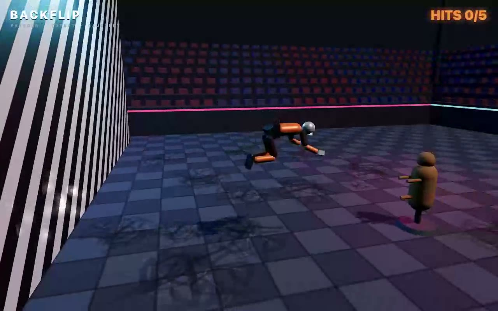
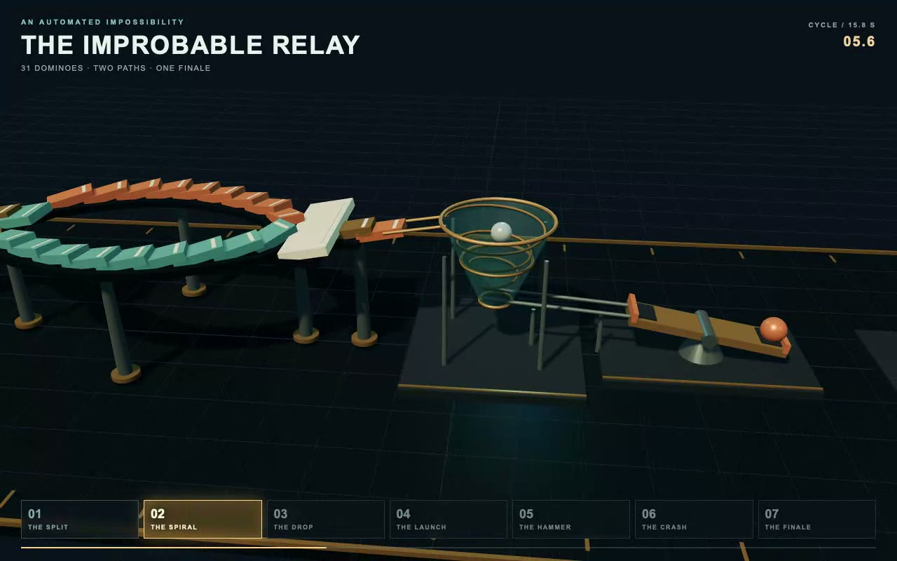
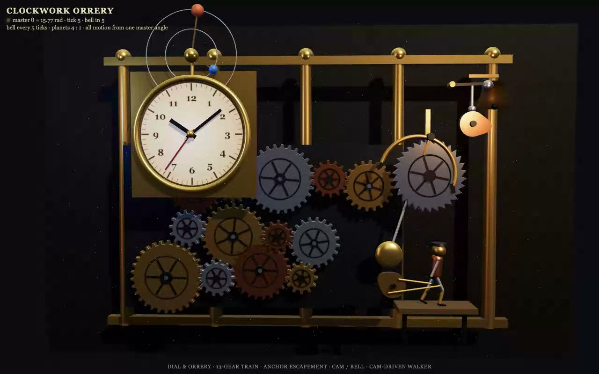
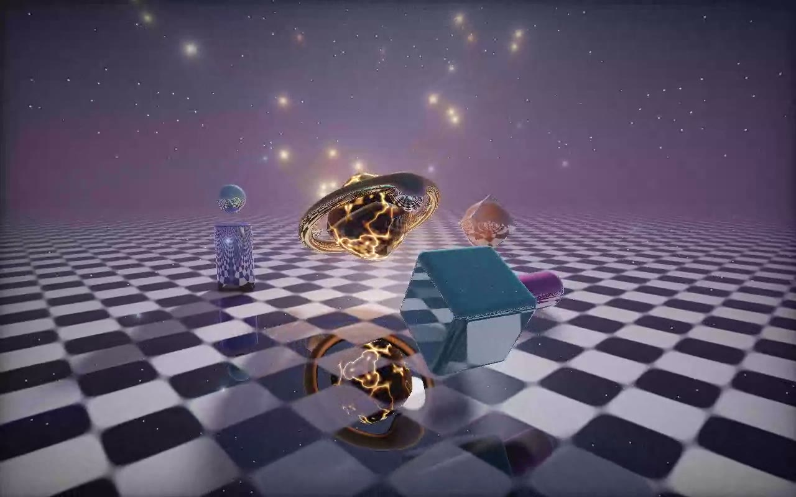

# 🦢 origami-bench

**How much can a model fold into 12,000 tokens?** *(every model at its maximum reasoning effort, labelled on the page: e.g. "Opus 5.5 · max")*

▶ **Live results, one big player (pick task and model, clip or live scene, side-by-side compare): https://zorahrel.github.io/origami-bench/**

A small, reproducible benchmark that gives every model the same short prompt, asks for **one self-contained HTML file** (three.js scene, chain-reaction physics, raymarching shader…) under a hard **12,000-token output budget**, then *actually runs it*: headless WebKit, 15-second video, automatic health checks, and a **panel of three vendor-diverse video judges**.

No humans voting, no leaderboard to overfit to: four prompts you can read in a minute (`tasks/tasks.json`) and swap for your own.

[](https://zorahrel.github.io/origami-bench/#walker)
[](https://zorahrel.github.io/origami-bench/#physics)
[](https://zorahrel.github.io/origami-bench/#gears)
[](https://zorahrel.github.io/origami-bench/#shader)

*Best-scoring output per task, re-rendered at 1280x800 (full videos `docs/hero-*.mp4`, also on the live page). Every one of the cells has its own 15 s clip: `runs/<date>/<model>/<task>/clip.mp4`.*

## Why few tokens?

Anyone can get a good demo from 50k tokens of output. The interesting question is **density**: how much *working* complexity (articulated joints, collisions, shadows, ray-marched geometry) a model packs into a small budget **on the first try**, with no tools, no retries and no external assets. It is also a cheap proxy for "will this model one-shot a small, visual, self-checking piece of code?".

## Leaderboard (run of 2026-10-13, v3 tasks, every model at MAX reasoning effort)

**Every contestant ran at the highest reasoning effort its CLI offers, and the label is part of the model name everywhere (page, player, report):**

| model label | how the maximum was set |
|---|---|
| Claude Opus 5.5 · max, Sonnet 5.5 · max, Haiku 5.5 · max | `claude -p --effort max` (levels: low, medium, high, xhigh, max) |
| gpt-6-sol · xhigh, gpt-6-luna · xhigh | `codex exec -c model_reasoning_effort="xhigh"` (highest Codex value; accepted by both models) |
| Muse Spark 1.3 · ultra, Muse Wonder Full 1.0 · ultra | `muse exec --reasoning-effort ultra` (levels: none ... max, ultra) |
| free-auto · default (no effort setting) | the free router exposes no effort knob |

The effort used is stored per cell in `runs/<date>/<model>/<task>/meta.json` (`"effort"`), shown in the player and in `results/<date>.md`. The judge panel is not part of this setting (same judges as before).

Mean over 4 tasks. Score = mean of the 3-judge panel, 1-10 (fixed rubric, capped at 4 if no animation is detected).

| # | model · effort | score | time (4 tasks) | output tokens | animated | clean |
|---|---|---|---|---|---|---|
| 1 | Claude Opus 5.5 · max | **7.8** | 8,310 s | 688,379\* | 4/4 | 4/4 |
| 2 | Muse Wonder Full 1.0 · ultra | 7.4 | 892 s | ~20,878† | 4/4 | 4/4 |
| 3 | Claude Sonnet 5.5 · max | 7.2 | 10,227 s | 1,101,538\* | 4/4 | 4/4 |
| 4 | Muse Spark 1.3 · ultra | 7.2 | 614 s | ~16,166† | 4/4 | 4/4 |
| 5 | gpt-6-sol · xhigh | 6.0 | 955 s | 60,229\* | 3/4 | 3/4 |
| 6 | free-auto · default (no effort setting) | 5.2 | 820 s | 28,473 | 3/4 | 3/4 |
| 7 | gpt-6-luna · xhigh | 4.8 | 1,304 s | 70,984\* | 2/4 | 3/4 |
| 8 | Claude Haiku 5.5 · max | 2.3 | 9,175 s | 1,558,954\* | 1/4 | 2/4 |

What max effort changed: the Claude models got slower by 10-30x (up to 61 minutes for one Sonnet cell) and burned 100k-390k hidden reasoning tokens per cell for a 12-19 KB page, and Opus and Sonnet now lead or sit near the top (the earlier 8k-token default-effort run scored them 6.0 and 6.5, but on easier tasks with one judge, so that is not a like-for-like gain). **Haiku at max effort failed hardest**: on walker and physics its reasoning exceeded Claude Code's 128k output cap and no HTML came back (recorded as errors in `meta.json`), and its shader is a text dump. Codex gpt-6-luna and gpt-6-sol each lost a cell to a GLSL compile error or a JS syntax error.

\* Counts include hidden reasoning tokens, so every Claude/Codex cell is "over budget" in the report even though every HTML file is under 32 KB. The budget in the prompt is a *request*; the harness reports the overshoot but does not discard the cell.
† Estimated from characters (chars / 3.5) because that CLI does not expose usage.

Earlier runs are kept for reference (default effort, not comparable): [`results/2026-10-13.md`](results/2026-10-13.md), [`results/2026-10-12.md`](results/2026-10-12.md).

Full per-cell table with judge notes: [`results/2026-10-13-v3.md`](results/2026-10-13-v3.md). Every generated page is in `runs/2026-10-13-v3/<model>/<task>/out.html`: open it in a browser.

**Read it with care:** one run per cell, scores are noisy by roughly ±1. Differences below ~0.5 are a tie.

## The four tasks (v3: extreme, long chained sequences)

| id | what the model must build |
|---|---|
| `walker` | Articulated fighter (full joint hierarchy, hands and feet) in a looping ~15 s gauntlet: sprint, **wall-run** along a striped wall (4+ steps), **wall-jump into a backflip**, roll landing, **5-hit combo** (jab, cross, roundhouse, spinning slash with weapon-arc trail, ground slam with shockwave ring), an enemy dummy that staggers per hit and collapses, **camera cut to slow-motion close-up** on the slam, dust, fog, coloured rim lights, on-screen phase name + hit counter |
| `physics` | **Extreme Rube-Goldberg chain**, no physics library: 20+ dominoes in an S-curve with a **branch that re-merges** → marble spirals down a funnel tower → seesaw launches a ball → **pendulum hammer** smashes a block stack → falling blocks tip a **pulley bucket** that hoists a flag and lights a lamp in the last second. Numbered stage labels (1-7), tracking camera, dust puffs, auto-reset |
| `gears` | **Clockwork orrery-automaton**, all motion from one master angle: 12+ meshing gears (3+ sizes, correct tooth counts), anchor escapement + pendulum ticking once per second, dial with hour/minute/second hands, **cam-and-follower hammer** that rings a bell every 5th tick, an **orrery arm with 2 planets at 1:4**, and a **walking mini-figure** whose legs are driven by a second cam through linkages. Layered 3D, metallic materials, camera drift |
| `shader` | Full-screen raymarched SDF with **6+ primitive types** and animated smooth-min morphing over a reflective checkered floor, soft shadows, AO, one-bounce reflections, fresnel, **emissive lava cracks**, floating particles, filmic tone mapping, fog, and a **spline camera fly-through** (orbit + dive + rise). Must compile first try, march loop under 128 steps |

v3 vs v2: the budget goes from 8,000 to **12,000 tokens** and clips from 10 s to **15 s**, because the prompts now describe 7+ chained stages that need a timeline or state machine; the point is still *density per token*, but a model that cannot fit the sequence at all no longer scores just by showing a fragment. All prompts share one preamble: a single HTML file, three.js r170 from the CDN, no addons, no input, no console errors, under 12,000 tokens, raw HTML only.

## How a cell is scored

1. **Generate**: the model's adapter runs the prompt; the HTML is extracted from the reply; time and tokens are recorded.
2. **Render** (`render.py`): headless **WebKit** via Playwright, 640x400, 15 s video. `three.module.js` is served from `vendor/` so runs are offline-reproducible.
3. **Automatic checks**: no console errors · canvas not blank (pixel std-dev and distinct levels) · **animation detected** = mean difference between 5 screenshots exceeds a threshold in at least 2 of 4 pairs.
4. **Judge panel** (see below): three vendor-diverse vision models each score the cell 1-10 with a strict rubric that **rewards complexity actually achieved** (a prompted mechanism that is not visible earns nothing; 9-10 only if the judge can name three specific working details). The cell score is the mean. A blank page scores 1 without calling the judges; no detected animation caps the score at 4.

A VLM judge is fine for "does it move, does it look rich", and not for fine geometry. That is all this needs.

## Run it

Requirements: Python 3.9+, `pip install playwright && playwright install webkit`, `ffmpeg` (frame diffs, clips), plus whichever model CLIs you want to test.

```bash
./bench list
./bench run                                   # every model x every task, today's date
./bench run --models opus-5.5 --tasks walker,gears --force
./bench run --no-judge                        # generation + automatic checks only
./bench report --date 2026-10-13-v3              # rebuild results/<date>.md
python3 hero.py 2026-10-13-v3               # best cell per task re-rendered at 1280x800 -> docs/hero-*.mp4
./bench clips  --date 2026-10-13-v3              # every cell -> clip.mp4 + poster.jpg (committed)
python3 site.py 2026-10-13-v3 "note"          # rebuild index.html (the player)
```

Finished cells are cached in `runs/<date>/<model>/<task>/` (`out.html`, `meta.json`, `auto.json`, `judge.json`, `clip.mp4`, `poster.jpg`; full-size videos and raw replies are git-ignored), so adding a model only runs that model.

### Judge panel

`judges/panel.py` (the default) calls three judges from different vendors, stores each answer as `judge_<name>.json` next to `judge.json` (the mean), and reports per-judge scores and agreement in `results/<date>.md`:

| judge | model | how | frames |
|---|---|---|---|
| `codex` | gpt-6-luna (OpenAI) | `codex exec` on a ChatGPT subscription, no API key | 24 over the 15 s |
| `router` | Gemini (Google): `gemini-3.8-flash`, falling back to `gemini-3.5-flash-lite` when the free quota is out | any OpenAI-compatible endpoint with vision (here a local free router) | 8 |
| `claude` | claude-haiku-5-5 (Anthropic) | `claude -p` on a subscription | 8 |

Disclosure: Claude and GPT models also compete, so no single judge decides: that is the reason for the panel. The Anthropic judge is a Claude model and the OpenAI judge is a GPT model, and the Gemini judge is in practice the most lenient (it hands out 8-10 easily, which is why the rubric asks it to name concrete achieved details). Per-judge columns are on the leaderboard and the page so the bias is visible. Add or swap a judge by editing the `JUDGES` list in `judges/panel.py`; `judges/gemini.py` (native video upload with `GEMINI_API_KEY`) is still there. To use any other single judge, set `BENCH_JUDGE_CMD` to a command that reads `$VIDEO` and `$PROMPT_FILE` and prints `SCORE: <n>` on the first line.

## Add a model (one line)

Append to `models.conf` (or to a git-ignored `models.local.conf`):

```
name        adapter    argument
my-model    claude     claude-opus-5-5
```

| adapter | runs |
|---|---|
| `claude <model-id>` | `claude -p --model <id> --effort max` (Claude Code CLI) |
| `codex <model>` | `codex exec -m <model> -c model_reasoning_effort="xhigh"` |
| `openai <model>` | any OpenAI-compatible `/chat/completions` endpoint (`BENCH_OPENAI_BASE`, `BENCH_OPENAI_KEY`): OpenRouter, vLLM, Ollama, LiteLLM… |
| `agentdir <command>` | a CLI agent called as `<command> -C <dir> <prompt>` that may save an `.html` instead of replying with it |
| `cmd <shell command>` | anything else: reads the prompt from `$PROMPT_FILE`, prints the HTML (or a reply containing it) to stdout |

## Add or change a task

Edit `tasks/tasks.json`: `preamble` is shared, each entry under `tasks` is the specific ask. Keep prompts short and identical for every model; that is the point.

## Prior art, and what was reused

- **Pelican riding a bicycle** (Simon Willison): one fixed prompt, code output, judge by looking. This is the template. https://simonwillison.net/tags/pelican-riding-a-bicycle/ · https://github.com/simonw/pelican-bicycle. Its known weakness (labs may train on the exact prompt, so leaderboards saturate) is why the tasks here are original and easy to rotate; see also alternative prompts at https://gally.net/temp/20251107pelican-alternatives/about.html
- **WebDev Arena** (LMArena): pairwise human votes on generated sites. https://arena.ai/blog/webdev-arena. Not reusable (needs people), but it inspired the fixed rubric.
- **Design Arena**: human-voted leaderboards for websites, via https://benchlm.ai/benchmarks/designarenawebsite. Same limitation, and tuned for sites rather than 3D/animation.
- **Three.js / voxel one-shot tests**: no standardised benchmark found at the time of writing, only informal community comparisons; hence the 3D tasks here.

## Limits

- 1 run per cell, 1 judge: noisy (±1). Re-run with `--force` and average if a ranking matters.
- Token counts for some CLIs include reasoning and others are estimated from characters; compare them as orders of magnitude, not exact figures.
- Wall-clock time includes queueing and network on free or shared endpoints.
- WebKit headless only; a page that needs WebGL features WebKit lacks will score as broken.
- The judge sees 640x400 video: fine detail is invisible to it.

## License

MIT, see [`LICENSE`](LICENSE). Bundled `vendor/three.module.js` is three.js r170, also MIT (see `vendor/NOTICE.txt`).
