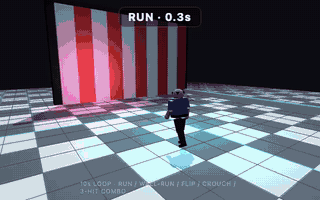

# 🦢 origami-bench

**How much can a model fold into 8,000 tokens?**

▶ **Live results, every scene clickable: https://zorahrel.github.io/origami-bench/**

A tiny, reproducible benchmark that gives every model the same short prompt, asks for **one self-contained HTML file** (three.js scene, physics sandbox, raymarching shader…) under a hard **8,000-token output budget**, then *actually runs it*: headless WebKit, 7-second video, automatic health checks, and a video-judge score.

No humans voting, no leaderboard to overfit to: four prompts you can read in a minute (`tasks/tasks.json`) and swap for your own.

| Walking humanoid | Physics sandbox |
|---|---|
|  |  |
| **Clockwork machine** | **Raymarched SDF** |
|  |  |

*Best-scoring output per task (walker: Muse Spark 1.3; the other three: Sonnet 5.5). **Every cell's own 10 s clip is on the [live page](https://zorahrel.github.io/origami-bench/)** (`runs/<date>/<model>/<task>/clip.mp4`, ≤ 300 KB each).

## Why few tokens?

Anyone can get a good demo from 50k tokens of output. The interesting question is **density**: how much *working* complexity (articulated joints, collisions, shadows, ray-marched geometry) a model packs into a small budget **on the first try**, with no tools, no retries and no external assets. It is also a cheap proxy for "will this model one-shot a small, visual, self-checking piece of code?".

## Leaderboard (run of 2026-10-13, hard tasks)

Mean over 4 tasks. Score = video-judge rating 1-10 (fixed rubric, capped at 4 if no animation is detected). **One judge for every row:** `judges/codex.py` (gpt-6-luna, 16 frames sampled from each 10 s video).

| # | model | score | time (4 tasks) | output tokens | animated | clean |
|---|---|---|---|---|---|---|
| 1 | Claude Sonnet 5.5 | **6.5** | 630 s | 80,284\* | 4/4 | 4/4 |
| 2 | Muse Wonder Full 1.0 | 6.5 | 749 s | ~15,535† | 4/4 | 4/4 |
| 3 | Muse Spark 1.3 | 6.2 | 213 s | ~10,259† | 4/4 | 4/4 |
| 4 | Claude Opus 5.5 | 6.0 | 722 s | 70,328\* | 4/4 | 4/4 |
| 5 | gpt-6-luna | 5.5 | 791 s | 107,748\* | 3/4 | 4/4 |
| 6 | free-auto (free router) | 3.8 | 746 s | 22,814 | 2/4 | 3/4 |

The previous run (2026-10-12, easy tasks, mostly a different judge for the Muse rows) is kept in [`results/2026-10-12.md`](results/2026-10-12.md) and [previous-run page](https://zorahrel.github.io/origami-bench/previous-run.html): the same models scored 4.0-7.2 there. Scores across the two runs are not directly comparable (different tasks, and a different judge for some rows).

\* Counts include hidden reasoning tokens, which is why some cells are flagged "over budget" in the report even though every HTML file is under 16 KB. The budget in the prompt is a *request*; the harness reports the overshoot but does not discard the cell.
† Estimated from characters (chars / 3.5) because that CLI does not expose usage.

Full per-cell table with judge notes: [`results/2026-10-13.md`](results/2026-10-13.md). Every generated page is in `runs/2026-10-13/<model>/<task>/out.html`: open it in a browser.

**Read it with care:** one run per cell, one judge, scores are noisy by roughly ±1. Differences below ~0.5 are a tie.

## The four tasks (v2: chained sequences, not demos)

| id | what the model must build |
|---|---|
| `walker` | Articulated fighter (joint hierarchy) in a looping ~10 s parkour-combat sequence: run at a wall, **wall-run**, push off into a **flip**, land in a crouch, **3-hit combo** (punch, kick, spin kick / slash), reset. Following camera that changes angle per phase, soft shadows, coloured light, fog, on-screen phase name |
| `physics` | **Rube-Goldberg chain** without a physics library: 12+ dominoes → ball down a ramp → lever/seesaw launches a second ball → stack of blocks falls → lamp lights / flag rises. Each stage must cause the next; numbered stage labels light up; tracking camera; auto-reset |
| `gears` | **Clockwork automaton** driven by one master angle: 8+ gear train with correct ratios, anchor escapement + swinging pendulum, second/minute hands at 1:60, a cam-and-follower that fires a small figure (hammer + bell / bird) in sync with the ticks |
| `shader` | Raymarched SDF scene: 4+ different primitives with **animated smooth-min blending** over a floor, soft shadows, AO, **one-bounce reflections**, fresnel glow, tone mapping, orbiting look-at camera. Must compile first try |

Why 10 s videos (was 7 s): the walker and Rube-Goldberg prompts describe a sequence of 5-6 phases; in 7 s the judge would only see half of it. The 8,000-token budget is unchanged, which is the point: these prompts need real structure (state machines, timelines) that a model has to compress.

All share one preamble: a single HTML file, three.js r170 from the CDN, no addons, no input, no console errors, under 8,000 tokens, raw HTML only.

## How a cell is scored

1. **Generate**: the model's adapter runs the prompt; the HTML is extracted from the reply; time and tokens are recorded.
2. **Render** (`render.py`): headless **WebKit** via Playwright, 640x400, 10 s video. `three.module.js` is served from `vendor/` so runs are offline-reproducible.
3. **Automatic checks**: no console errors · canvas not blank (pixel std-dev and distinct levels) · **animation detected** = mean difference between 4 screenshots exceeds a threshold in at least 2 of 3 pairs.
4. **Judge**: the video goes to a vision model with a fixed rubric (1-2 blank/broken/static · 3-4 poor or off-task · 5-6 recognisable, simple animation · 7-8 task met well with lights/shadows/depth · 9-10 surprising, near-professional). A blank page scores 1 without calling the judge; no detected animation caps the score at 4.

A VLM judge is fine for "does it move, does it look rich", and not for fine geometry. That is all this needs.

## Run it

Requirements: Python 3.9+, `pip install playwright && playwright install webkit`, `ffmpeg` (frame diffs and GIFs), plus whichever model CLIs you want to test.

```bash
./bench list
./bench run                                   # every model x every task, today's date
./bench run --models opus-5.5 --tasks walker,gears --force
./bench run --no-judge                        # generation + automatic checks only
./bench report --date 2026-10-12              # rebuild results/<date>.md
./bench gifs   --date 2026-10-12              # best cell per task -> docs/*.gif
./bench clips  --date 2026-10-12              # every cell -> clip.mp4 + poster.jpg (committed)
python3 site.py 2026-10-12 "Judge: ..."       # rebuild index.html
```

Finished cells are cached in `runs/<date>/<model>/<task>/` (`out.html`, `meta.json`, `auto.json`, `judge.json`, `clip.mp4`, `poster.jpg`; full-size videos and raw replies are git-ignored), so adding a model only runs that model.

### Judge

Two judges ship with the repo. `judges/gemini.py` sends the video to Gemini (set `GEMINI_API_KEY`; a free key from Google AI Studio works, mind the daily quota). `judges/codex.py` needs no API key (it uses the `codex` CLI on a ChatGPT subscription): it samples 16 frames and applies the same rubric. The 2026-10-13 run used it for every cell because the free Gemini quota was exhausted that night (`gemini-3.5-flash-lite` still answered, but it rated almost everything 8-10, which hides differences on hard tasks; its answers are kept as `judge_gemini.json` for cross-checking). The judge model is also a contestant (gpt-6-luna), but it ranked itself 5th. To use any other judge, set `BENCH_JUDGE_CMD` to a shell command that reads `$VIDEO` and `$PROMPT_FILE` and prints `SCORE: <n>` on its first line followed by a short justification.

## Add a model (one line)

Append to `models.conf` (or to a git-ignored `models.local.conf`):

```
name        adapter    argument
my-model    claude     claude-opus-5-5
```

| adapter | runs |
|---|---|
| `claude <model-id>` | `claude -p --model <id>` (Claude Code CLI) |
| `codex <model>` | `codex exec -m <model>` |
| `openai <model>` | any OpenAI-compatible `/chat/completions` endpoint (`BENCH_OPENAI_BASE`, `BENCH_OPENAI_KEY`): OpenRouter, vLLM, Ollama, LiteLLM… |
| `agentdir <command>` | a CLI agent called as `<command> -C <dir> <prompt>` that may save an `.html` instead of replying with it |
| `cmd <shell command>` | anything else: reads the prompt from `$PROMPT_FILE`, prints the HTML (or a reply containing it) to stdout |

## Add or change a task

Edit `tasks/tasks.json`: `preamble` is shared, each entry under `tasks` is the specific ask. Keep prompts short and identical for every model; that is the point.

## Prior art, and what was reused

- **Pelican riding a bicycle** (Simon Willison): one fixed prompt, code output, judge by looking. This is the template. https://simonwillison.net/tags/pelican-riding-a-bicycle/ · https://github.com/simonw/pelican-bicycle. Its known weakness (labs may train on the exact prompt, so leaderboards saturate) is why the tasks here are original and easy to rotate; see also alternative prompts at https://gally.net/temp/20251107pelican-alternatives/about.html
- **WebDev Arena** (LMArena): pairwise human votes on generated sites. https://arena.ai/blog/webdev-arena. Not reusable (needs people), but it inspired the fixed rubric.
- **Design Arena**: human-voted leaderboards for websites, via https://benchlm.ai/benchmarks/designarenawebsite. Same limitation, and tuned for sites rather than 3D/animation.
- **Three.js / voxel one-shot tests**: no standardised benchmark found at the time of writing, only informal community comparisons; hence the 3D tasks here.

## Limits

- 1 run per cell, 1 judge: noisy (±1). Re-run with `--force` and average if a ranking matters.
- Token counts for some CLIs include reasoning and others are estimated from characters; compare them as orders of magnitude, not exact figures.
- Wall-clock time includes queueing and network on free or shared endpoints.
- WebKit headless only; a page that needs WebGL features WebKit lacks will score as broken.
- The judge sees 640x400 video: fine detail is invisible to it.

## License

MIT, see [`LICENSE`](LICENSE). Bundled `vendor/three.module.js` is three.js r170, also MIT (see `vendor/NOTICE.txt`).
